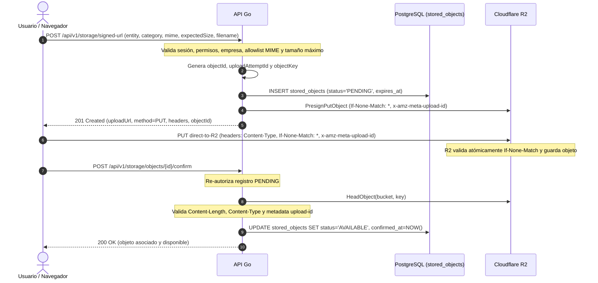
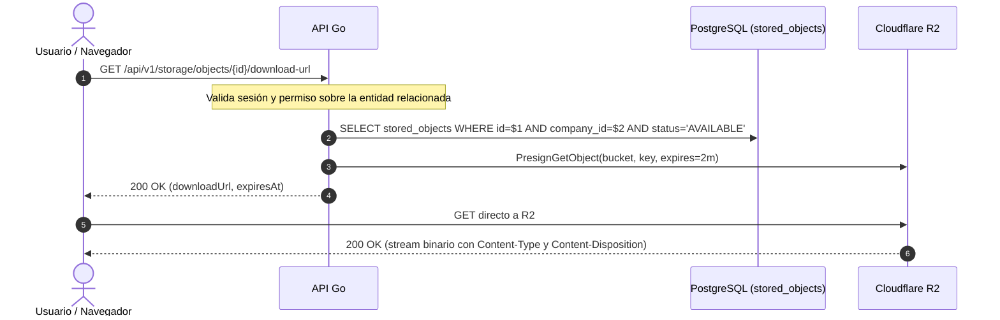
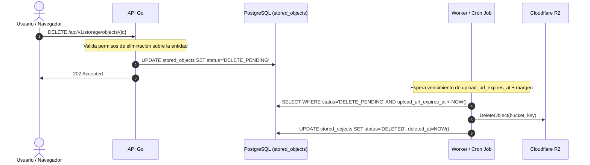

# Almacenamiento de Archivos y Objetos — Cloudflare R2

**Estado:** decisión arquitectónica aprobada; implementación backend y migración SQL pendientes.  
**Proveedor de producción:** Cloudflare R2 (API compatible con Amazon S3).  
**Servicios de soporte:** PostgreSQL (metadatos y relaciones en Supabase), Go (autorización, firma y ciclo de vida).

---

## 1. Visión general y límites de arquitectura

Cloudflare R2 es el proveedor exclusivo para el almacenamiento de objetos binarios (fotografías de servicio, comprobantes de pago, documentos técnicos y adjuntos) en TechService. **Supabase Storage no forma parte de la arquitectura del sistema.** Supabase se conserva únicamente para identidad externa (Supabase Auth) y persistencia transaccional (PostgreSQL).

```text
                  Navegador / PWA (Next.js)
                  ├── Presenta UI y captura archivos
                  ├── Conserva temporales offline en IndexedDB
                  └── Transfiere binarios directo a R2 con URLs prefirmadas
                               │                    │
              1. Pide URL      │                    │ 3. PUT / GET directo
              4. Confirma      │                    │    (con headers firmados)
                               ▼                    ▼
                           API Go              Cloudflare R2
                   (Autenticación,         (Bucket privado por env;
                    autorización, firmas,   almacena únicamente bytes)
                    auditoría y metadata)
                               │
                               ▼
                      Supabase PostgreSQL
                   (Tabla `stored_objects`:
                    metadatos, estado y FKs)
```

### Principios fundamentales

1. **Separación de bytes y metadatos:** PostgreSQL almacena metadatos, estado del ciclo de vida, relaciones de negocio y propiedad multiempresa. R2 almacena únicamente los bytes binarios. Nunca se guardan binarios en PostgreSQL ni URLs prefirmadas en la base de datos.
2. **Transferencia directa navegador-R2 (direct-to-R2):** Para no sobrecargar el proceso Go ni el servidor Next.js, los binarios se envían directamente desde el navegador a R2 mediante URLs prefirmadas de vida corta. Go no actúa como proxy de archivos pesados.
3. **Control total de autorización en Go:** El navegador no tiene acceso directo a R2 ni credenciales S3/R2. Go genera la key interna (UUID), define los límites (MIME, tamaño), firma la URL y valida con `HeadObject` antes de marcar el archivo como disponible y asociarlo a una entidad.
4. **Desacoplamiento mediante arquitectura hexagonal:** Go interactúa con R2 mediante una interfaz interna (`ObjectStorage`) y un adaptador S3-compatible (`adapters/storage/s3compatible`). El dominio y la capa de aplicación no importan SDKs propietarios ni tipos de Cloudflare/AWS.

### Estrategia de pruebas en local (Filesystem) vs Producción (Cloudflare R2)

Para agilizar el desarrollo inicial sin depender de infraestructura externa desde el primer momento:

* **Modo Local (`STORAGE_PROVIDER=local`):** Go usa un adaptador simple basado en el sistema de archivos local (`adapters/storage/filesystem`), guardando los binarios en una carpeta en disco (`./uploads`). La URL devuelta para carga y descarga apunta a endpoints locales de la propia API Go.
* **Modo Producción (`STORAGE_PROVIDER=r2`):** Go usa el adaptador S3-compatible (`adapters/storage/s3compatible`) contra el endpoint de Cloudflare R2 con URLs prefirmadas reales.
* **Desacoplamiento total:** Ambas implementaciones cumplen la misma interfaz `ObjectStorage`. El caso de uso, la base de datos `stored_objects` y el frontend operan exactamente con el mismo flujo; la conmutación de `local` a `r2` se realiza únicamente cambiando la variable de entorno `STORAGE_PROVIDER`.

---

## 2. Flujos operativos y diagramas de secuencia

### 2.1 Flujo de carga (Direct Upload con URL prefirmada)



1. **Solicitud de carga:** El cliente solicita subir un archivo aportando metadatos declarados.
2. **Autorización y emisión:** Go valida los permisos del usuario activo sobre la entidad, crea el registro `PENDING` en PostgreSQL y genera una URL `PUT` prefirmada con vencimiento corto (5 minutos) con condición atómica `If-None-Match: *` y metadata `upload-id`.
3. **Carga directa:** El navegador sube el archivo a R2 enviando exactamente los headers firmados.
4. **Confirmación:** El cliente notifica a Go. Go ejecuta `HeadObject` contra R2, comprueba que el tamaño real y el tipo coincidan con lo autorizado y que `x-amz-meta-upload-id` coincida con el intento actual. Tras validar, cambia el estado a `AVAILABLE`.

### 2.2 Flujo de descarga



1. **Solicitud:** El cliente pide ver o descargar un archivo.
2. **Autorización:** Go consulta `stored_objects` validando aislamiento por `company_id` y relación con la entidad.
3. **Emisión de descarga:** Go firma una URL `GET` con TTL corto (2 minutos).
4. **Entrega:** El navegador obtiene el binario directamente desde R2. Las imágenes seguras se entregan `inline`; los documentos sensibles como `attachment`.

### 2.3 Flujo de eliminación



1. **Baja lógica inicial:** Se marca `DELETE_PENDING` en PostgreSQL y se retorna `202 Accepted`.
2. **Espera de seguridad:** Un worker asíncrono espera a que la URL `PUT` original haya expirado para evitar que una petición demorada recree el archivo después del borrado.
3. **Borrado físico:** El worker invoca `DeleteObject` en R2 y actualiza el registro a `DELETED` para auditoría.

---

## 3. Aislamiento multiempresa y convención de claves

El aislamiento de archivos descansa en tres capas obligatorias:

1. **Autorización en Go:** Go obtiene la empresa (`company_id`) desde la sesión y valida membresía y pertenencia de la entidad. El cliente nunca puede fijar o alterar el `company_id` del archivo.
2. **Ruta jerárquica con UUIDs no predecibles:** Las claves de objeto nunca usan nombres originales ni datos personales (DNI, CUIT, email).

```text
companies/{companyId}/services/{serviceId}/{category}/{objectId}
```

* `companyId`: UUID de la empresa propietaria.
* `serviceId`: UUID del servicio o entidad funcional.
* `category`: categoría cerrada (`photos`, `receipts`, `documents`).
* `objectId`: UUID v4 generado por Go al emitir la URL.

3. **Bucket privado por ambiente:** Entornos aislados (`development`, `staging`, `production`) con buckets independientes y credenciales de acceso restringidas por bucket.

---

## 4. Metadatos en PostgreSQL: tabla `stored_objects`

La persistencia de metadatos se implementa en la tabla `stored_objects` (pendiente de migración por el operador):

| Campo | Tipo | Descripción |
|---|---|---|
| `id` | `uuid` | Clave primaria generada por Go |
| `company_id` | `uuid` | Empresa propietaria (FK lógica a `company`) |
| `storage_provider` | `text` | Proveedor activo (`r2`) |
| `bucket_name` | `text` | Nombre del bucket del entorno |
| `object_key` | `text` | Key completa dentro del bucket |
| `entity_type` | `text` | Tipo de entidad (`service`, `payment`, `client`) |
| `entity_id` | `uuid` | Identificador de la entidad relacionada |
| `category` | `text` | Categoría funcional (`photos`, `receipts`, `documents`) |
| `original_filename` | `text` | Nombre original saneado para visualización |
| `content_type` | `text` | MIME validado (`image/jpeg`, `image/png`, `application/pdf`) |
| `expected_size_bytes`| `bigint` | Tamaño declarado por el cliente |
| `size_bytes` | `bigint` | Tamaño real comprobado con `HeadObject` |
| `checksum_sha256` | `text` | Checksum SHA-256 (opcional) |
| `uploaded_by_id` | `uuid` | Usuario interno que realizó la carga |
| `status` | `text` | `PENDING`, `AVAILABLE`, `DELETE_PENDING`, `DELETED`, `FAILED` |
| `upload_url_expires_at` | `timestamptz` | Expiración de la URL PUT (protección anti-replay) |
| `upload_attempt_id` | `uuid` | ID de intento firmado en metadata `x-amz-meta-upload-id` |
| `created_at` | `timestamptz` | Fecha de creación del registro |
| `confirmed_at` | `timestamptz` | Fecha de confirmación exitosa |
| `deleted_at` | `timestamptz` | Fecha de borrado físico confirmado |

### Restricciones e índices

- `UNIQUE(storage_provider, bucket_name, object_key)`
- `INDEX idx_stored_objects_company_status (company_id, status, created_at)`
- `INDEX idx_stored_objects_entity (entity_type, entity_id, status)`
- `CHECK (status IN ('PENDING', 'AVAILABLE', 'DELETE_PENDING', 'DELETED', 'FAILED'))`
- `CHECK (category IN ('photos', 'receipts', 'documents'))`

---

## 5. Seguridad, CORS y límites técnicos

### Política CORS del bucket R2

Es independiente de la CORS de la API Go. Aplica a las peticiones browser-to-R2:

```json
[
  {
    "AllowedOrigins": ["https://app.techservice.com"],
    "AllowedMethods": ["PUT", "GET"],
    "AllowedHeaders": ["Content-Type", "If-None-Match", "x-amz-meta-upload-id"],
    "ExposeHeaders": ["ETag"],
    "MaxAgeSeconds": 3600
  }
]
```

### Cabeceras firmadas obligatorias

El navegador debe enviar de forma idéntica:
- `Content-Type`: MIME validado.
- `If-None-Match: *`: previene sobrescrituras accidentales. R2 responde `412 Precondition Failed` si la key ya existe.
- `x-amz-meta-upload-id`: UUID del intento de carga para evitar carreras entre reintentos.

### Límites de tamaño y tipos permitidos

| Tipo de archivo | Allowlist MIME | Tamaño máximo sugerido |
|---|---|---|
| Fotografías | `image/jpeg`, `image/png`, `image/webp` | 10 MiB |
| Documentos y comprobantes | `application/pdf`, `image/jpeg`, `image/png` | 20 MiB |

Formatos ejecutables o con riesgo de script (SVG, HTML, JS) están **estrictamente prohibidos**.

---

## 6. Manejo PWA y sincronización offline

En operaciones de campo (técnicos sin conectividad):
1. La captura de foto se almacena temporalmente en **IndexedDB** local del navegador como `Blob`/`File`.
2. Se encola la operación de sincronización en IndexedDB.
3. Al recuperar conectividad:
   - La PWA solicita a Go la URL prefirmada (`POST /api/v1/storage/signed-url`).
   - Sube el binario directo a R2 (`PUT`).
   - Confirma la carga en Go (`POST /api/v1/storage/objects/{id}/confirm`).
   - Solo tras confirmación exitosa de Go, se purga el blob temporal de IndexedDB.
4. Las URLs prefirmadas **nunca se guardan en IndexedDB ni en caché offline** por tener vencimiento corto.

---

## 7. Documentos relacionados

- [Módulo backend: Archivos y Storage](../.backend/modulos/archivos-storage.md)
- [Contrato HTTP de API](../.backend/api.md)
- [Configuración de entorno del backend](../.backend/configuration.md)
- [Esquema de base de datos PostgreSQL](../.backend/database.md)
- [Arquitectura backend Go](./backend-architecture.md)
- [Arquitectura frontend y PWA](./frontend-architecture.md)
- [Uso de archivos desde frontend](./frontend-storage.md)
- [Infraestructura y despliegue](./infrastructure.md)
- [Plan de implementación backend (Fase 7)](../ejecuciones/backend-implementation-plan.md)
